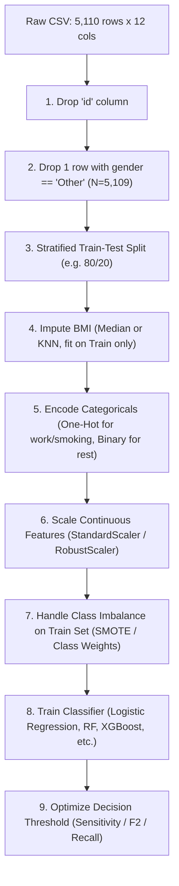

# Kaggle Stroke Prediction Dataset: Schema, Clinical Feature Definitions, and Data Quirks

**Dataset Reference:** `healthcare-dataset-stroke-data.csv`  
**Kaggle Source:** [`fedesoriano/stroke-prediction-dataset`](https://www.kaggle.com/datasets/fedesoriano/stroke-prediction-dataset)  
**Primary Origin:** McKinsey & Company Healthcare Analytics Online Hackathon (Analytics Vidhya, 2018)  
**Investigation Date:** October 2026  
**Scope:** Clinical epidemiology, schema verification, missing data mechanisms, demographic distributions, and data preprocessing standards.

---

## 1. Executive Summary & Dataset Provenance

The **Stroke Prediction Dataset** hosted on Kaggle by user `fedesoriano` consists of **5,110 patient observations across 12 attributes**. The dataset was originally released by **McKinsey & Company** in 2018 as part of the *McKinsey Analytics Online Hackathon* on Analytics Vidhya to benchmark machine learning algorithms for predicting cerebrovascular accidents (strokes) from electronic health records (EHR).

The dataset represents an observational cohort combining demographic factors, comorbid chronic vascular conditions, lifestyle behaviors, and continuous clinical biomarkers. The target variable is binary stroke occurrence (`stroke` $\in \{0, 1\}$), exhibiting substantial class imbalance (~4.87% positive event rate).

### Key Takeaways for Modeling & Clinical Pipeline Design:
1. **Critical Non-Random Missingness in BMI:** 201 records (3.93%) lack BMI. Patients with missing BMI exhibit an acute stroke prevalence of **19.90%** (40/201) compared to **4.26%** (209/4,909) in complete records (Odds Ratio = 5.59). **Dropping missing BMI records (complete-case analysis) eliminates 16.06% of all positive stroke cases in the dataset**, introducing severe selection bias.
2. **Low-Frequency Singleton Category in Gender:** A single observation contains `gender == 'Other'`. This singleton creates rank-deficiency / single-split errors and should be cleanly dropped, yielding $N = 5,109$.
3. **Paediatric Masking in Smoking Status:** Of the 1,544 records (30.22%) with `smoking_status == 'Unknown'`, 682 (44.17%) are paediatric patients aged $< 18$. The category is not random noise but a structured epidemiological artifact of pediatric intake protocols.
4. **Target Imbalance:** Exactly 249 stroke events out of 5,110 records (4.873%, ratio $\approx 19.5:1$). Clinical triage objectives require optimizing for sensitivity (recall) and PR-AUC / ROC-AUC rather than raw accuracy.

---

## 2. Complete Schema & Clinical Feature Definitions

The dataset contains 12 columns: 1 identifier, 3 continuous numeric biomarkers, 3 binary flags, and 5 categorical variables.

| Column Name | CSV Type | Target Pandas Dtype | Clinical Feature Definition | Measurement Unit | Allowed / Observed Domain | Missingness Count (%) |
| :--- | :--- | :--- | :--- | :--- | :--- | :--- |
| `id` | Integer | `int64` | Anonymized patient intake record identifier | N/A (Index) | [67 – 72,940] | 0 (0.00%) |
| `gender` | String | `category` / `str` | Biological sex or documented gender | Categorical | `Male` (2,115), `Female` (2,994), `Other` (1) | 0 (0.00%) |
| `age` | Float | `float64` | Patient chronological age at clinical contact | Years (decimal) | [0.08 – 82.00] years | 0 (0.00%) |
| `hypertension` | Integer | `int64` (binary) | Clinically diagnosed chronic arterial hypertension | Binary flag (0/1) | 0: No (4,612; 90.25%) 1: Yes (498; 9.75%) | 0 (0.00%) |
| `heart_disease` | Integer | `int64` (binary) | Documented history of cardiovascular disease (e.g. CAD, MI) | Binary flag (0/1) | 0: No (4,834; 94.60%) 1: Yes (276; 5.40%) | 0 (0.00%) |
| `ever_married` | String | `category` / `str` | Lifetime marital status history | Binary string | `Yes` (3,353; 65.62%) `No` (1,757; 34.38%) | 0 (0.00%) |
| `work_type` | String | `category` / `str` | Primary employment / occupational category | Categorical | `Private` (2,925), `Self-employed` (819), `children` (687), `Govt_job` (657), `Never_worked` (22) | 0 (0.00%) |
| `Residence_type` | String | `category` / `str` | Living environment classification | Binary string | `Urban` (2,596; 50.80%) `Rural` (2,514; 49.20%) | 0 (0.00%) |
| `avg_glucose_level` | Float | `float64` | Average blood glucose concentration | $\text{mg/dL}$ | [55.12 – 271.74] $\text{mg/dL}$ | 0 (0.00%) |
| `bmi` | Float / String | `float64` | Body Mass Index ($\text{weight}_{\text{kg}} / \text{height}_{\text{m}}^2$) | $\text{kg/m}^2$ | [10.30 – 97.60] $\text{kg/m}^2$ | 201 (3.93%) |
| `smoking_status` | String | `category` / `str` | Documented tobacco smoking history | Categorical | `never smoked` (1,892), `Unknown` (1,544), `formerly smoked` (885), `smokes` (789) | 0 (0.00%) |
| `stroke` | Integer | `int64` (binary) | **Primary Target:** Acute cerebrovascular event occurrence | Binary label (0/1) | 0: No Stroke (4,861; 95.13%) 1: Stroke (249; 4.87%) | 0 (0.00%) |

---

## 3. Detailed Variable Breakdown & Clinical Significance

### 3.1. Identifier: `id`
- **Definition:** Arbitrary positive integer assigned during EHR extraction.
- **Min / Max:** 67 to 72,940.
- **Clinical Utility:** None. Must be excluded from exploratory correlation matrices, statistical regressions, and ML training pipelines to prevent data leakage or spurious indexing artifacts.

### 3.2. Biological Sex: `gender`
- **Distribution:** Female: 2,994 (58.59%), Male: 2,115 (41.39%), Other: 1 (0.02%).
- **Stroke Rates:**
  - Female: 141 strokes / 2,994 = 4.71%
  - Male: 108 strokes / 2,115 = 5.11%
  - Other: 0 strokes / 1 = 0.00%
- **Clinical Consideration:** Men carry higher age-adjusted stroke risk in middle age, while women face longer lifespans and elevated post-menopausal stroke burden.

### 3.3. Age: `age`
- **Units:** Years (expressed as continuous floating-point values).
- **Summary Statistics:**
  - Mean: 43.23 years (SD 22.61)
  - Median: 45.00 years
  - Interquartile Range (IQR): [25.00 – 61.00] years
  - Extremes: Min = 0.08 years (~29 days old, 1 month infant); Max = 82.00 years.
- **Stratified Stroke Risk:**
  - Paediatric ($< 18$ years): 2 strokes / 856 = 0.23%
  - Young Adult ($18 - 39$ years): 6 strokes / 1,314 = 0.46%
  - Middle-Aged ($40 - 59$ years): 60 strokes / 1,564 = 3.84%
  - Senior ($60 - 79$ years): 141 strokes / 1,190 = 11.85%
  - Geriatric ($80+$ years): 40 strokes / 186 = 21.51%
- **Correlation with Stroke:** Pearson $r = +0.245$ (the strongest single linear predictor in the dataset).

### 3.4. Chronic Hypertension: `hypertension`
- **Definition:** Chronic elevation of arterial blood pressure ($\ge 130/80\ \text{mmHg}$ or anti-hypertensive medication therapy according to AHA/ACC guidelines).
- **Prevalence:** 498 patients (9.75% of cohort).
- **Stroke Rate:**
  - Hypertension present ($1$): 66 strokes / 498 = **13.25%**
  - Hypertension absent ($0$): 183 strokes / 4,612 = **3.97%**
  - Crude Relative Risk ($\text{RR}$) $\approx 3.34$; Odds Ratio ($\text{OR}$) $\approx 3.69$.
- **Clinical Relevance:** Hypertension is globally recognized as the single most critical modifiable risk factor for both ischemic and hemorrhagic stroke.

### 3.5. Heart Disease: `heart_disease`
- **Definition:** Clinical manifestation of cardiovascular pathology (including coronary artery disease, history of myocardial infarction, or chronic valvular/arrhythmic disease).
- **Prevalence:** 276 patients (5.40% of cohort).
- **Stroke Rate:**
  - Heart disease present ($1$): 47 strokes / 276 = **17.03%**
  - Heart disease absent ($0$): 202 strokes / 4,834 = **4.18%**
  - Crude Relative Risk ($\text{RR}$) $\approx 4.07$; Odds Ratio ($\text{OR}$) $\approx 4.71$.

### 3.6. Marital Status: `ever_married`
- **Distribution:** Yes: 3,353 (65.62%), No: 1,757 (34.38%).
- **Stroke Rate:**
  - Ever Married (`Yes`): 220 strokes / 3,353 = **6.56%**
  - Never Married (`No`): 29 strokes / 1,757 = **1.65%**
- **Epidemiological Note:** This strong association is confounded by age. Unmarried individuals include the entire paediatric cohort ($N=856$) and younger adults (median age for `No` is 21.0 years vs 51.0 years for `Yes`). When adjusted for age in multivariable logistic regression, this association diminishes.

### 3.7. Employment: `work_type`
- **Categories:**
  - `Private`: 2,925 (57.24%) — Stroke rate: 5.09% (149/2,925)
  - `Self-employed`: 819 (16.03%) — Stroke rate: **7.94%** (65/819)
  - `children`: 687 (13.44%) — Stroke rate: 0.29% (2/687)
  - `Govt_job`: 657 (12.86%) — Stroke rate: 5.02% (33/657)
  - `Never_worked`: 22 (0.43%) — Stroke rate: 0.00% (0/22)
- **Age Confounding:** The `children` category strictly encompasses individuals aged 0.08 to 16.0 years (mean age 6.84 years). `Never_worked` encompasses ages 13 to 23 years (mean age 16.18 years). Self-employed patients have higher average age (mean 54.1 years), which explains their higher raw stroke rate.

### 3.8. Residence: `Residence_type`
- **Distribution:** Urban: 2,596 (50.80%), Rural: 2,514 (49.20%).
- **Stroke Rate:**
  - Urban: 135 strokes / 2,596 = 5.20%
  - Rural: 114 strokes / 2,514 = 4.53%
- **Clinical Evaluation:** Near 50/50 balance. Slight urban elevation, but difference is not statistically significant ($\chi^2 \approx 1.05, p = 0.306$).

### 3.9. Average Blood Glucose: `avg_glucose_level`
- **Units:** $\text{mg/dL}$ (milligrams per deciliter).
- **Summary Statistics:**
  - Mean: 106.15 $\text{mg/dL}$ (SD 45.28)
  - Median: 91.89 $\text{mg/dL}$
  - IQR: [77.25 – 114.09] $\text{mg/dL}$
  - Extremes: Min = 55.12 $\text{mg/dL}$, Max = 271.74 $\text{mg/dL}$.
- **Distribution:** Bimodal. Peak 1 is centered in the normal range (80–95 mg/dL). Peak 2 forms a right tail (> 180–240 mg/dL) reflecting impaired fasting glucose and poorly controlled type 2 diabetes mellitus.
- **Clinical Glycemic Strata (American Diabetes Association thresholds):**
  - Normal Fasting ($< 100\ \text{mg/dL}$): 3,131 patients (61.27%) — Stroke rate: 3.58% (112/3,131)
  - Impaired / Prediabetic ($100 - 125\ \text{mg/dL}$): 998 patients (19.53%) — Stroke rate: 3.71% (37/998)
  - Elevated / Diabetic Range ($\ge 126\ \text{mg/dL}$): 981 patients (19.20%) — Stroke rate: **10.19%** (100/981)
- **Clinical Relevance:** Hyperglycemia damages vascular endothelium, accelerating micro- and macro-vascular atherogenesis. Diabetic patients carry roughly a 2.8-fold increased stroke incidence.

### 3.10. Body Mass Index: `bmi`
- **Units:** $\text{kg/m}^2$ (kilograms per meter squared).
- **Summary Statistics (Observed $N = 4,909$):**
  - Mean: 28.89 $\text{kg/m}^2$ (SD 7.85)
  - Median: 28.10 $\text{kg/m}^2$
  - IQR: [23.50 – 33.10] $\text{kg/m}^2$
  - Extremes: Min = 10.30 $\text{kg/m}^2$, Max = 97.60 $\text{kg/m}^2$.
- **WHO Weight Categories:**
  - Underweight ($< 18.5\ \text{kg/m}^2$): 337 (6.86%) — Stroke rate: 0.30% (1/337)
  - Normal ($18.5 - 24.9\ \text{kg/m}^2$): 1,224 (24.93%) — Stroke rate: 3.02% (37/1,224)
  - Overweight ($25.0 - 29.9\ \text{kg/m}^2$): 1,409 (28.70%) — Stroke rate: 5.32% (75/1,409)
  - Class I Obesity ($30.0 - 34.9\ \text{kg/m}^2$): 1,000 (20.37%) — Stroke rate: 5.40% (54/1,000)
  - Class II Obesity ($35.0 - 39.9\ \text{kg/m}^2$): 509 (10.37%) — Stroke rate: 6.48% (33/509)
  - Class III / Severe Obesity ($\ge 40.0\ \text{kg/m}^2$): 430 (8.76%) — Stroke rate: 2.09% (9/430)
- **Missing Values:** Exactly 201 records (3.93%) are stored as `N/A` or empty.

### 3.11. Smoking Status: `smoking_status`
- **Categories:**
  - `never smoked`: 1,892 (37.03%) — Stroke rate: 4.76% (90/1,892)
  - `Unknown`: 1,544 (30.22%) — Stroke rate: 3.04% (47/1,544)
  - `formerly smoked`: 885 (17.32%) — Stroke rate: **7.91%** (70/885)
  - `smokes`: 789 (15.44%) — Stroke rate: 5.32% (42/789)
- **Clinical Observation:** "Formerly smoked" exhibits the highest stroke rate because older patients often cease smoking only after developing cardiovascular or metabolic symptoms ("sick quitter effect").

### 3.12. Target Variable: `stroke`
- **Binary Coding:** 0 = No history/diagnosis of stroke, 1 = Documented stroke.
- **Distribution:**
  - Negative ($0$): 4,861 (95.127%)
  - Positive ($1$): 249 (4.873%)
- **Imbalance Ratio:** $19.52 : 1$.

---

## 4. Deep Dive into Missingness: The BMI Phenomenon

### 4.1. Prevalence and Quantitative Profile
Of the 5,110 records, only `bmi` contains missing values ($N = 201$, 3.933%). All other 11 features have 0 missing values.

Comparative analysis between complete and incomplete cohorts:

| Metric | Records with BMI Present ($N=4,909$) | Records with Missing BMI ($N=201$) | $p$-value / Effect Size |
| :--- | :--- | :--- | :--- |
| **Stroke Cases** | 209 (4.26%) | **40 (19.90%)** | $\chi^2 = 91.53, p < 10^{-20}$ |
| **Odds of Stroke** | 0.0445 | 0.2484 | **$\text{OR} = 5.59$ (95% CI: 3.84 – 8.13)** |
| **Mean Age** | 42.87 years (SD 22.56) | **52.05 years (SD 22.28)** | $t = -5.73, p < 10^{-8}$ |
| **Hypertension Rate** | 9.19% (451/4,909) | **23.38% (47/201)** | $\chi^2 = 43.14, p < 10^{-10}$ |
| **Heart Disease Rate** | 4.95% (243/4,909) | **16.42% (33/201)** | $\chi^2 = 47.78, p < 10^{-11}$ |
| **Mean Avg Glucose** | 105.31 mg/dL (SD 44.42) | **126.72 mg/dL (SD 59.24)** | $t = -4.99, p < 10^{-6}$ |

### 4.2. Etiology and Clinical Context
Missingness in BMI is **strictly not Missing Completely at Random (MCAR)**. It exhibits characteristics of **Missing at Random (MAR)** conditioned on age and comorbidity status, and likely **Missing Not at Random (MNAR)** due to clinical acute care mechanics:
- Patients presenting with acute stroke, severe cerebrovascular compromise, or altered mental status are admitted via the Emergency Department / Stroke Unit.
- Standing height and weight cannot be obtained from bedridden, paralyzed, or comatose patients on a standard stadiometer and clinical scale.
- Anthropometric measurements are deferred in favor of emergency head CT/MRI neuroimaging, IV thrombolysis (r-tPA), or mechanical thrombectomy.
- Conversely, ambulatory outpatients undergoing routine checkups routinely have height and weight logged.

### 4.3. Preprocessing Consequences
- **Complete Case Analysis (Listwise Deletion):** Discarding the 201 rows with missing BMI deletes **40 out of 249 stroke cases (16.06% of all target positives)**. This artificially deflates the positive minority class, distorts the true baseline event rate, and introduces survival/presentation bias into trained classifiers.
- **Imputation Strategy:**
  - Imputation using the median ($\approx 28.1\ \text{kg/m}^2$) or median stratified by age group and gender preserves record count and sample size.
  - Advanced multivariate imputation (MICE / `IterativeImputer` or $k\text{-NN}$ imputer with $k=5$) accurately infers expected BMI conditioned on `age`, `avg_glucose_level`, and `hypertension`.
  - Adding a binary indicator column `bmi_is_missing` ($1$ if imputed, $0$ otherwise) captures the predictive signal of missingness.

---

## 5. Known Quirks, Anomalies & Edge Cases

### 5.1. The Singleton Category: `gender == 'Other'`
- **Record Identifier:** Row index 3116 (`id = 56156`).
- **Profile:** Age 26.0, female-leaning clinical metrics, hypertension 0, heart_disease 0, ever_married No, work_type Private, Residence_type Rural, avg_glucose_level 143.33, bmi 22.4, smoking_status formerly smoked, **stroke = 0**.
- **Issue:** Having exactly 1 observation for a 3-level categorical factor causes single-value splits in decision trees, unstratified train/test splits, or singular matrices during dummy/one-hot encoding if present in test but not train (or vice-versa).
- **Resolution:** Drop this single non-stroke record prior to modeling. The final clean dataset becomes $N = 5,109$ (Female: 2,994, Male: 2,115, Stroke cases: 249, No-stroke: 4,860).

### 5.2. The 'Unknown' Category in `smoking_status`
- **Volume:** 1,544 patients (30.22% of total cohort).
- **Demographic Distribution:**
  - 682 of these 1,544 (44.17%) are paediatric patients aged $< 18$ years.
  - In fact, among all 856 children ($< 18$) in the dataset, **79.67% (682/856)** have `smoking_status == 'Unknown'`.
- **Etiology:** Paediatric clinical assessment forms typically do not administer adult tobacco screening questionnaires to infants and small children.
- **Resolution:** "Unknown" represents an informative category reflecting younger age and absence of recorded smoking history. Do not discard these rows or impute them as random missing values. They should be treated as an explicit categorical level in one-hot encoding or recoded into a domain category (e.g. `non-smoker / unexposed` for paediatric patients).

### 5.3. Paediatric Cohort vs. Adult Stroke Pathophysiology
- **Paediatric Count:** 856 patients (16.75%) have $\text{age} < 18$.
- **Observed Stroke Cases in Children:** Exactly 2 patients:
  1. `id = 69768`: Female, **age 1.32 years** (~16 months old), hypertension 0, heart_disease 0, glucose 70.37, BMI missing, stroke = 1.
  2. `id = 49669`: Female, **age 14.00 years**, hypertension 0, heart_disease 0, glucose 57.93, BMI 30.9, stroke = 1.
- **Clinical Insight:** Adult stroke is overwhelmingly thromboembolic and atherothrombotic, driven by decades of vascular shear stress, hypertension, diabetes, and hyperlipidemia. Paediatric stroke (incidence 2–3 per 100,000 children/year) is etiologically distinct, arising from congenital heart defects, arteriopathies (e.g. Moyamoya, dissection), sickle cell disease, or perinatal complications.
- **Modeling Recommendation:** If building an adult-specific clinical risk calculator, filtering the training cohort to $\text{age} \ge 18$ avoids fitting adult risk multipliers to paediatric baselines. If retaining the full cohort, tree-based models naturally partition at age cutoffs.

### 5.4. Extreme BMI Outliers
- **Distribution Upper Tail:**
  - 13 patients have $\text{bmi} > 60\ \text{kg/m}^2$.
  - Maximum observed: $\text{bmi} = 97.60\ \text{kg/m}^2$ (`id = 56420`, Male, age 17).
  - Next highest: $\text{bmi} = 92.00\ \text{kg/m}^2$ (`id = 51856`, Male, age 38).
- **Clinical Plausibility:** While super-super morbid obesity ($\text{BMI} > 60$) exists clinically, values near 100 are exceedingly rare and may reflect data entry transcription errors (e.g. recording pounds instead of kilograms, or waist circumference instead of BMI). None of the 13 patients with $\text{bmi} > 60$ had a stroke.
- **Handling:** For linear and logistic models sensitive to extreme leverage points, apply upper-percentile winsorization (e.g. 99th percentile cutoff at $53.4\ \text{kg/m}^2$) or robust scaling. Tree ensembles (Random Forest, XGBoost) are rank-invariant and handle these values without degradation.

---

## 6. Standard Preprocessing Conventions in Literature

Reviewing peer-reviewed literature and high-performing machine learning benchmarks using this dataset (e.g. IEEE, Springer, PubMed, Analytics Vidhya) yields the following standardized workflow:

### Step-by-Step Clinical Preprocessing Protocol:
1. **Feature Pruning:** Drop `id` immediately.
2. **Filtering Singleton Anomaly:** Filter out `gender == 'Other'` (1 record dropped).
3. **Partitioning:** Perform Stratified $K$-Fold or Stratified Train-Test Split prior to any transformation to prevent data leakage.
4. **BMI Imputation:** Fit the imputer strictly on the training partition:
   - *Option A (Baseline):* Median imputation ($\approx 28.1\ \text{kg/m}^2$).
   - *Option B (Recommended):* Multivariate imputation via $k$-NN ($k=5$) or `IterativeImputer` using `age`, `avg_glucose_level`, and `hypertension`.
   - *Option C:* Retain a binary feature `bmi_nan_flag` to preserve the diagnostic signal of emergency hospital presentation.
5. **Categorical Encoding:**
   - Binary mappings: `ever_married` (`Yes`: 1, `No`: 0), `Residence_type` (`Urban`: 1, `Rural`: 0), `gender` (`Male`: 1, `Female`: 0).
   - One-hot encoding: `work_type` (5 categories), `smoking_status` (4 categories, retaining `Unknown` as a distinct indicator).
6. **Feature Normalization:** Standardize continuous variables (`age`, `avg_glucose_level`, `bmi`) using `StandardScaler` or `RobustScaler` (especially if preserving high BMI outliers).
7. **Imbalance Mitigation:**
   - Synthetic oversampling: Apply SMOTE or Borderline-SMOTE *only* to the training partition.
   - Cost-sensitive learning: Pass `class_weight='balanced'` to Logistic Regression, Random Forest, or XGBoost (`scale_pos_weight = (5109 - 249)/249 \approx 19.5`).
8. **Clinical Evaluation Metrics & Threshold Tuning:**
   - Accuracy is clinically meaningless in this cohort (a naive model predicting all zeros achieves 95.1% accuracy but 0.0% sensitivity).
   - Target metrics: Recall (Sensitivity) for stroke detection, Precision-Recall AUC (PR-AUC), and ROC-AUC.
   - Clinical threshold tuning: Lower the operating decision threshold from default 0.50 to $0.10 - 0.25$ to prioritize patient capture over specificity.

---

## 7. Primary Sources & Citations

1. **Dataset Host (Kaggle):** fedesoriano. (2021). *Stroke Prediction Dataset*. Available from: [https://www.kaggle.com/datasets/fedesoriano/stroke-prediction-dataset](https://www.kaggle.com/datasets/fedesoriano/stroke-prediction-dataset).
2. **Original Benchmark Source:** McKinsey & Company. (2018). *McKinsey Analytics Online Hackathon: Healthcare Analytics Challenge*. Analytics Vidhya.
3. **Clinical Glycemic Standards:** American Diabetes Association (ADA). (2024). *Standards of Care in Diabetes—2024*. Diabetes Care 47(Suppl. 1): S1–S343.
4. **Obesity Classification Standards:** World Health Organization (WHO). (2000). *Obesity: preventing and managing the global epidemic*. WHO Technical Report Series 894.
5. **Stroke Risk Modeling Literature:**
   - Sailasya, G., & Arora, N. (2021). *Analyzing the Performance of Stroke Prediction using ML Techniques*. International Journal of Advanced Computer Science and Applications (IJACSA), 12(6).
   - Tazin, T., Alam, M. N., Dhruba, A. R., et al. (2021). *Stroke Disease Detection and Prediction Using Robust Machine Learning Approaches*. Journal of Healthcare Engineering, 2021, Article ID 7633381.
